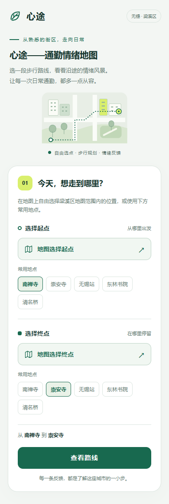
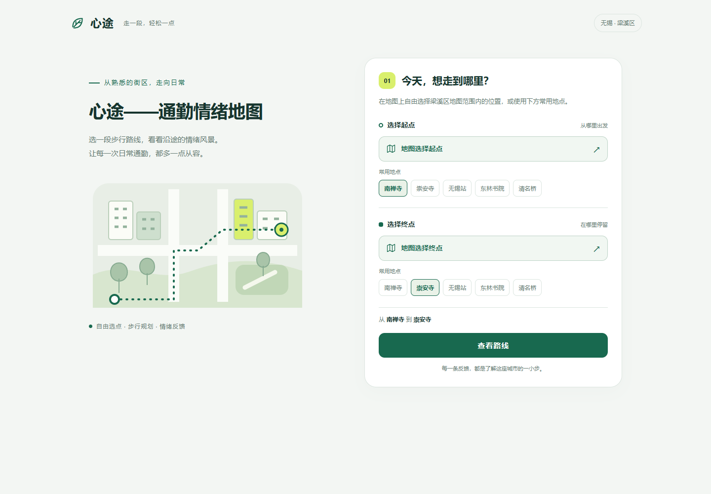

# 梁溪区城市范围升级验收

2026-10-23：产品更名为 **心途——通勤情绪地图**，服务场景扩展为无锡梁溪区日常步行通勤。当前提供高德步行路线，其他交通方式尚未实现。

## 地理与界面

- 使用高德行政区接口 `320213` 于本日返回的 GCJ-02 范围，原始边界和来源保存在 `data/geography/liangxi-amap-20261023.json`。运行时采用其外接矩形 `120.240331,31.512825,120.352851,31.630931`，不是精确行政边界围栏。
- 默认视野从校园街道级改为城区概览 zoom 12；选点初始 zoom 16，允许 11–19 级缩放。起终点可在地图范围内自由选择。
- 快捷地点为南禅寺、崇安寺、无锡站、东林书院、清名桥；均核实高德返回的梁溪区地点和坐标，记录见 `data/geography/liangxi-places-20261023.json`。默认行程为南禅寺至崇安寺。
- 首页、地图、路线页、网页标题、PWA 清单和 Android 显示名称统一新产品定位；插画改为城市街区。保留 Android 包标识以支持应用更新。

## 升级与数据

旧校园端点缓存及浏览器历史状态恢复到城区规划首页，不自动查询旧路线；设备身份、已保存历史及待确认的通勤操作不会被该缓存处理清空。超出当前范围的历史仍显示记录，但不能直接重新规划。

真实反馈仍默认 `REAL_ONLY`，没有数据就显示空状态；用户可主动切换有持续来源标记的演示热力图。内存 demo 的 500 条模拟报告已调整至梁溪地标周边，不参与真实评分或趋势。没有迁移或移动用户的真实反馈。

历史 PostgreSQL Flyway V3/V5 校园演示种子保持原样，未重写既有迁移；因此 PostgreSQL 的梁溪演示图暂为空，新增真实反馈按新位置正常查询。PostGIS 测试明确区分历史种子可读与梁溪模拟覆盖。当前手机验收后端使用新的独立内存实例，不迁移旧内存实例中的验收反馈；没有主动清理旧实例或数据库。

## 真实接口

新隔离后端关闭演示路线回退。真实高德查询南禅寺至崇安寺返回 HTTP 200：`REAL / WALKING`，1893 米、1514 秒、77 个路径点；快照及查询历史成功保存。无真实反馈时返回 `INSUFFICIENT_DATA`，未生成舒适路线结论。梁溪演示热力查询为 64 个单元、500 条模拟报告，来源均为 `DEMO`；真实热力为空。

手机验收仍依赖 USB 反向端口与本机后端，不代表已经完成独立网络部署。仓库正式构建的通勤写入开关仍默认关闭；当前专用验收包已对通过 D07 联调的独立后端启用记录，并持续提示“当前为体验环境，通勤记录仅在本次服务器运行期间保留”。先选择到达感受，再点击完成；没有路线评分也可保存。新开关不会跳过快照、操作幂等或待确认写入恢复。

## 压力色阶与城区交互

真实反馈、演示热力图、详情色点及反馈按钮共用同一压力色阶：0 蓝、25 青、50 黄、75 橙、100 红；中间数值连续插值。来源不影响颜色，置信度仍控制光晕透明度，不改变压力数值。图例显示五个刻度与低压、高压方向，缺失数据不补零。

城区概览下，相邻 44px 点击按钮按屏幕位置避免重叠，并保留当前选中的原始单元。全部热力光晕仍然渲染；放大地图会展开更多触点，提示用户查看细节。详情明确对应此单元格，未把周围单元的反馈数、压力或来源合成新的统计。

## 验证

- 前端单元：37 个文件、600 项全部通过，含旧缓存/身份/待确认通勤保留、蓝红色阶、稠密触点及缩放后细点恢复，以及保存前后临时记录提示。
- Chrome 浏览器：50/50，通过自由选点、来源切换、触屏拖动、四角详情与窄屏回归。
- PWA：5/5，清单名称与离线外壳可用，API 不进入缓存。城市后端全栈：4/4，通过反馈、快照、通勤幂等与跨页恢复。
- 后端隔离 Maven verify：220 项，0 失败、0 错误；本地 Docker 不可用，18 项数据库测试跳过。云端 Backend CI 继续强制数据库测试零跳过，合并前以本次提交的 CI 为准。
- TypeScript、Vite/PWA 与 Android debug 构建通过。启用通勤的专用 APK SHA256：`68AF70060AF5BD001720D03F3777272793CDF6E22FECF300B4CC9F9B7C0DBE4E`。专用构建传入 `VITE_COMMUTE_RECORDING_ENABLED=true` 与 `VITE_EPHEMERAL_RECORDS=true`；显示名为“心途——通勤情绪地图（验收）”。
- 专用包已安装并打开，USB 通道继续连接原运行中的梁溪后端，未清除应用数据或重启服务器。编译产物的浏览器验收确认选择到达感受后“完成本次通勤”可用，临时保存提示可见；未代替用户提交实际通勤。正式默认关闭版本的说明改为准确的“此版本尚未开放”，相应浏览器回归通过。
- 1440/390/320px 浏览器预览无横向溢出、无页面脚本异常；64 个模拟单元在城区概览下点击代表触点可打开原始详情。浏览器预览用于布局和交互检查，不能仅凭 `amap` 模式标记断言真实瓦片已加载，也不替代真机手感验收。

首页预览：

